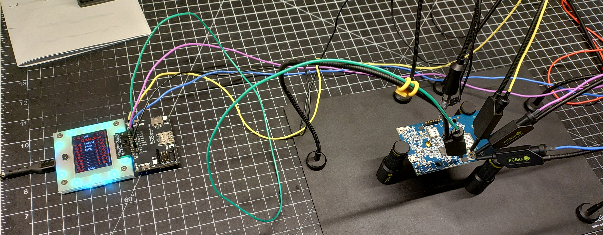

# buspirate-pySim-setup

This script sets a BusPriate 5 up for use with [pySim](https://github.com/osmocom/pysim) by automating the commands and calculations needed to set a BusPirate 5 up to act as a serial interface with a SIM card/IC.

## Requirements

This script requires you to install [pySerial](https://pyserial.readthedocs.io/en/latest/) in your Python enviornment.

## How to use it

This script is simple to set up and use. Simply modify the variables and run the script.

### Setup

1) Install [requirements](#requirements) above.
1) Open `buspirate-pySim-setup.py` with an editor.
2) Change the `SIM_*` and `BP_PORT_*` variables under the configuration section to match your BusPirate and SIM.

### Run it

1) Run `./buspirate-pySim-setup.py`.
2) Use pySim against the BusPirate's text console serial port.

## Credits

This script is based on work done in [this forum post](https://forum.buspirate.com/t/sle4442-smart-card-adapter-kf-011c/204/117) by `lawrence`.
